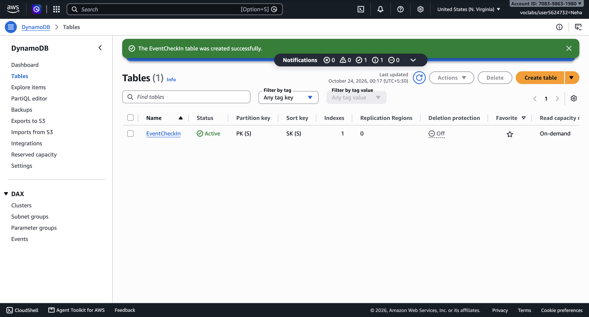
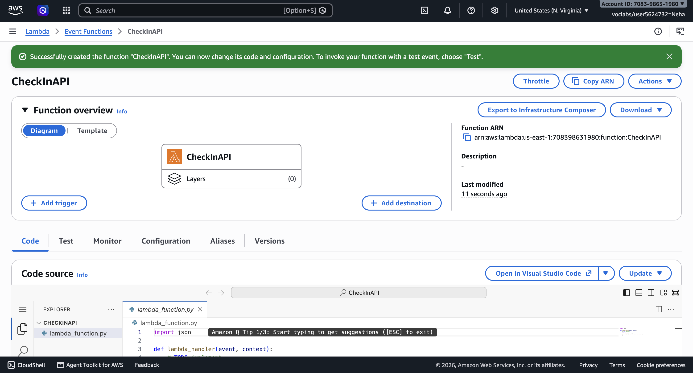
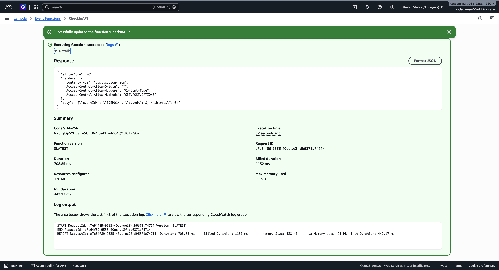
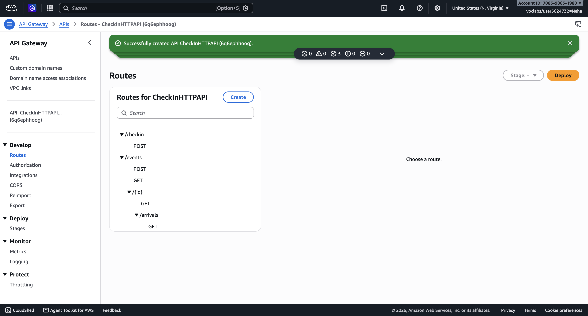
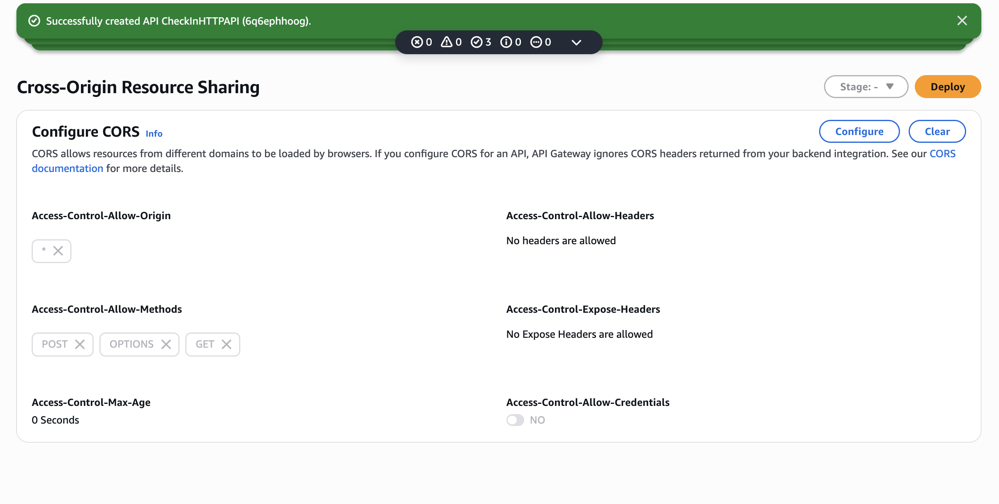
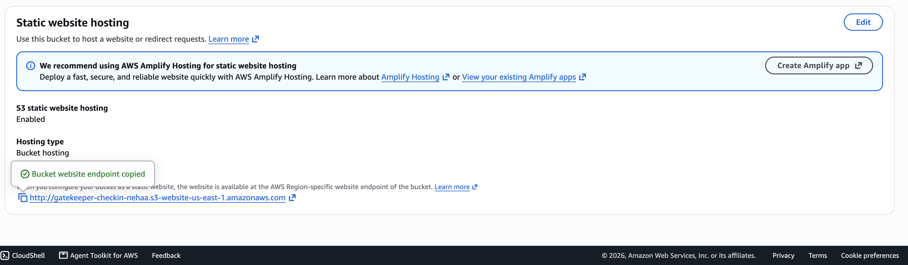
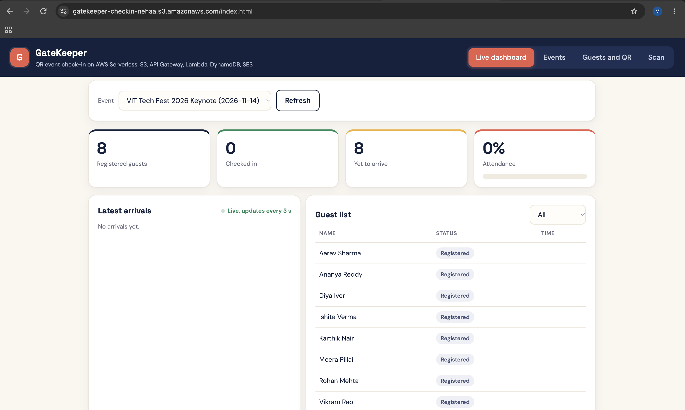
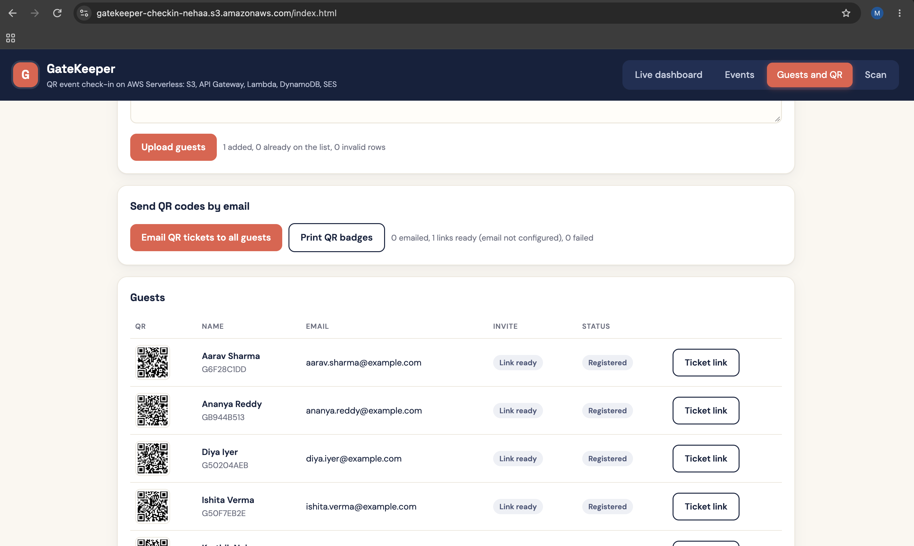
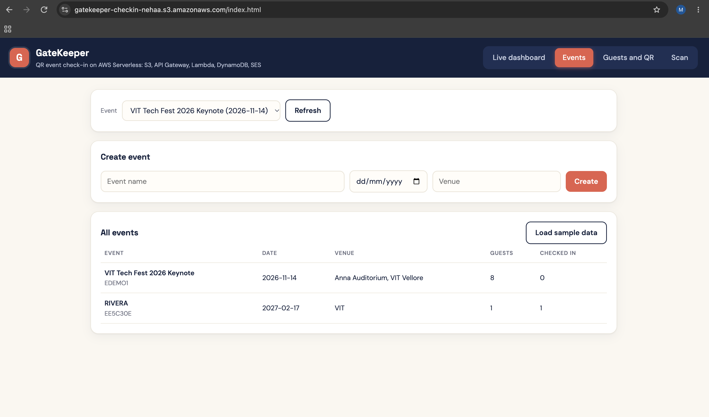
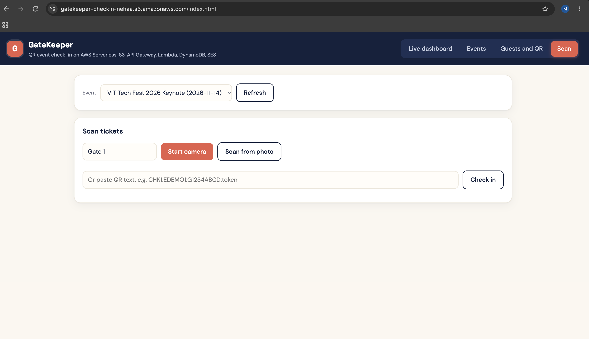

# GateKeeper: QR-Based Event Check-In and Attendance Tracker using AWS Serverless

The organizer uploads a guest list. Each guest gets a unique QR code by email. At the venue, staff scan the code and the guest is marked as checked in. A live dashboard shows who has arrived. A DynamoDB conditional write inside a transaction guarantees that a ticket can be used only once, even when two gates scan it at the same moment.

## Live links

| | |
|---|---|
| Web app (HTTPS, use this on phones for the camera scanner) | https://gatekeeper-checkin-nehaa.s3.amazonaws.com/index.html |
| S3 website endpoint | http://gatekeeper-checkin-nehaa.s3-website-us-east-1.amazonaws.com |
| API (HTTP API `CheckInHTTPAPI`) | https://6q6ephhoog.execute-api.us-east-1.amazonaws.com |

Deployed in the AWS Academy Learner Lab, region us-east-1 (N. Virginia).

## Architecture

```
Organizer / Staff / Guest browser
        |
        v
Amazon S3 (static website: index.html)
        |  HTTPS (fetch)
        v
Amazon API Gateway (HTTP API, 9 routes)
        |
        v
AWS Lambda (Python 3.12, CheckInAPI)
        |                     \
        v                      v
Amazon DynamoDB          Amazon SES
(EventCheckIn table      (QR ticket emails)
 + sparse GSI1)
        |
Amazon CloudWatch (logs and metrics)
```

## How it works

1. **Create event** (organizer): stored as an Event item.
2. **Upload guest list** (CSV `name,email`): each guest gets a random secret `ticketToken`. The QR code encodes `CHK1:<eventId>:<guestId>:<ticketToken>`. A conditional `PutItem` (`attribute_not_exists(PK)`) skips duplicate emails, so re-uploading a list never creates a second ticket.
3. **Email QR tickets**: Lambda sends each guest an email through Amazon SES with a link to their personal ticket page, which renders the QR code.
4. **Scan at the venue**: staff scan with the phone camera, a photo, or by pasting the code. Lambda runs one `TransactWriteItems` call:
   - Update the guest to `CHECKED_IN` **only if** `attribute_exists(PK) AND ticketToken = :token AND checkInStatus = :registered`
   - Increment `checkedInCount` on the event
   If the guest is already in, the condition fails, the whole transaction is cancelled, and the scanner shows **Already checked in** with the original time and gate.
5. **Live dashboard**: refreshes every 3 seconds with totals, attendance percentage and the latest arrivals.

## Data model (single table: `EventCheckIn`)

| Entity | PK | SK | GSI1PK | GSI1SK |
|---|---|---|---|---|
| Event | `EVENT#<eventId>` | `META` | `TYPE#EVENT` | `<date>#<eventId>` |
| Guest (registered) | `EVENT#<eventId>` | `GUEST#<guestId>` | not set | not set |
| Guest (checked in) | `EVENT#<eventId>` | `GUEST#<guestId>` | `ARRIVED#<eventId>` | `<checkedInAt>#<guestId>` |

GSI1 is a **sparse index**: a guest appears in it only after check-in, so the arrivals feed is a single Query sorted newest first.

## Access patterns

| # | Access pattern | DynamoDB operation |
|---|---|---|
| 1 | List all events by date | Query GSI1, `GSI1PK = TYPE#EVENT` |
| 2 | Get event with live counts | GetItem `EVENT#id`, `META` |
| 3 | List guests of an event | Query `PK = EVENT#id`, `SK begins_with GUEST#` |
| 4 | Add guest without duplicates | PutItem with `attribute_not_exists(PK)` |
| 5 | Check in a guest exactly once | TransactWriteItems with ConditionExpression |
| 6 | Latest arrivals, newest first | Query GSI1, `GSI1PK = ARRIVED#id`, `ScanIndexForward=false` |

## API

| Method | Route | Purpose |
|---|---|---|
| GET | `/events` | List events |
| POST | `/events` | Create event `{name, date, venue}` |
| GET | `/events/{id}` | Event details and counts |
| GET | `/events/{id}/guests` | Guest list with status |
| POST | `/events/{id}/guests` | Upload guests `{guests:[{name,email}]}` |
| POST | `/events/{id}/invites` | Email QR tickets `{baseUrl}` |
| GET | `/events/{id}/arrivals` | Latest 20 arrivals |
| POST | `/checkin` | Scan `{qr, staff}`: 200 checked in, 409 already in, 404 invalid |
| POST | `/seed` | Load a sample event with 8 guests |

## Deployment summary

1. **DynamoDB:** table `EventCheckIn`, keys `PK` / `SK` (String), on-demand, GSI `GSI1` on `GSI1PK` / `GSI1SK`, projection All.
2. **SES (optional):** verify the sender email (and, in the SES sandbox, each recipient email).
3. **Lambda:** `CheckInAPI`, Python 3.12, paste `lambda_function.py`, timeout 15 s, environment variables `TABLE_NAME=EventCheckIn` and `SENDER_EMAIL=<verified email>`.
4. **API Gateway:** HTTP API with the 9 routes integrated with `CheckInAPI`, CORS `*`, methods GET, POST, OPTIONS, header `content-type`.
5. **Frontend:** set `API_URL` in `index.html` to the invoke URL.
6. **S3:** bucket with static website hosting and a public-read policy. Use the HTTPS object URL (`https://<bucket>.s3.amazonaws.com/index.html`) on phones so the live camera scanner works; browsers allow camera access only on HTTPS pages.

## Testing

All 9 routes were tested against a mocked DynamoDB table and SES, including: duplicate guest upload, forged token, malformed QR, ticket used for the wrong event, and five simultaneous scans of the same QR (exactly one succeeds, four get 409, counter increases by one).

## AWS services used

Amazon DynamoDB, AWS Lambda, Amazon API Gateway, Amazon S3, Amazon SES, AWS IAM, Amazon CloudWatch.

## Screenshots

| | |
|---|---|
|  |  |
| DynamoDB table EventCheckIn, active, on-demand | Lambda function CheckInAPI |
|  |  |
| Lambda test: seed route, 201, 8 guests | API Gateway routes |
|  |  |
| API Gateway CORS | S3 static website hosting |
|  |  |
| Live dashboard | Guests with unique QR codes |
|  |  |
| Events | Scanner for gate staff |

## Student details

- **Name:** Nehaa Prabhu
- **Register number:**
- **Programme:** B.Tech Computer Science and Engineering (AI and ML), Vellore Institute of Technology, Vellore
- **Course:**
- **Faculty:**
- **GitHub:** https://github.com/nehaaprabhu
